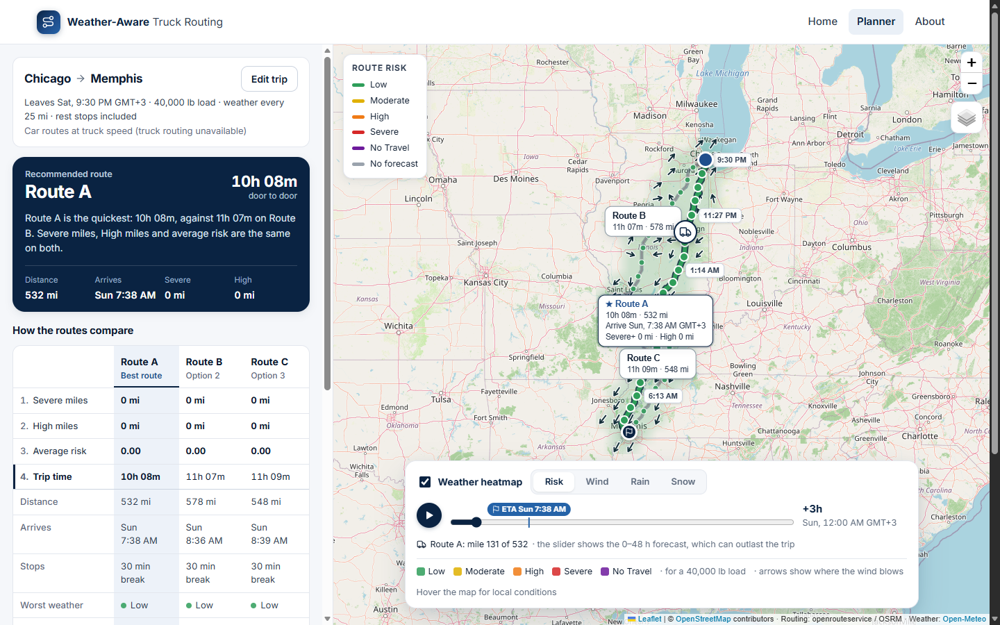

# Weather-Aware Truck Routing

A React + Django web app that helps a truck driver choose the safest route based on **weather, load weight and travel time**.

Enter an origin, destination, departure time and load weight. The app finds **3 route options**, checks the forecast every **10 / 25 / 50 miles** for the hour the truck will reach each point, rates the risk with the spec's rules and recommends a route. The map shows every route, checkpoint, risk level, ETA and route summary, plus a **weather heatmap along the corridor with a 0–48 h slider**.

**Live app:** https://weather-aware-truck-routing-jhonacestina.vercel.app/



## Requirements at a glance

| Requirement | Code | Tests |
|---|---|---|
| Origin, destination, departure, load weight | `TripForm.tsx`, `serializers.py` | `TripForm.test.tsx`, `test_api.py` |
| 3 route options from a routing API | `route_options.py`, `services/ors.py`, `services/osrm.py` | `test_route_options.py`, `test_ors.py` |
| Weather every 10 / 25 / 50 mi at the truck's ETA | `planner.py`, `services/weather.py` | `test_planner.py`, `test_weather.py` |
| Risk thresholds and load rules | `risk.py` (mirrored in `risk.ts` for the map) | `test_risk.py`, `risk.test.ts` |
| Recommendation (Severe → High → avg risk → time) | `recommend.py`, `RouteComparison.tsx` | `test_recommend.py`, `RouteComparison.test.tsx` |
| Routes, checkpoints, risk, ETAs, summaries on a map | `map/RoutesLayer.tsx`, `CheckpointTable.tsx` | `CheckpointTable.test.tsx`, `RouteComparison.test.tsx` |
| Corridor heatmap with a 0–48 h slider | `heatmap.py`, `map/heatmapFrames.ts`, `map/HeatmapControls.tsx` | `test_heatmap.py`, `heatmapFrames.test.ts`, `HeatmapControls.test.tsx` |

## Quick start

Requirements: Python 3.12+ and Node 20+. Run the backend and frontend in two terminals.

```bash
# Backend: http://127.0.0.1:8000
cd backend
python -m venv .venv
source .venv/bin/activate        # Windows PowerShell: .venv\Scripts\Activate.ps1
pip install -r requirements.txt
python manage.py runserver

# Frontend: http://127.0.0.1:5173 (forwards /api to Django)
cd frontend
npm install
npm run dev
```

Open **http://127.0.0.1:5173**.

**Truck routing (recommended).** Get a free key at [account.heigit.org](https://account.heigit.org) and set it before starting the backend: `export ORS_API_KEY=...` (PowerShell: `$env:ORS_API_KEY="..."`). Without a key, the app still works, using car routes capped at truck speed. Everything else (weather, place search, map tiles) is keyless.

Troubleshooting:
- PowerShell won't run `Activate.ps1`: run `Set-ExecutionPolicy -Scope Process Bypass` first, or call `.venv\Scripts\python manage.py runserver` directly.
- Port 8000 is taken: run `python manage.py runserver 8001` and start the frontend with `API_URL=http://127.0.0.1:8001 npm run dev`.
- The server needs outbound internet access. `HTTPS_PROXY` / `HTTP_PROXY` are honoured.

## How it works

```
React (Vite, TypeScript, react-leaflet)
   │  POST /api/plan    → routes, checkpoints, risk, recommendation
   │  POST /api/heatmap → 49-hour weather heatmap for those routes' corridor
   ▼
Django REST API ── route_options ── openrouteservice (truck roads) + OSRM (road speeds; car fallback)
               ├── weather ──────── Open-Meteo hourly forecast
               ├── geocoding ────── Open-Meteo, Photon fallback
               ├── risk / planner / recommend / heatmap
```

### Routes (`route_options.py`, `services/ors.py`)
- **Truck roads.** Routes come from openrouteservice's heavy-goods-vehicle profile, given the truck's gross weight (load + 33,000 lb empty truck), so roads with a lower weight limit are avoided.
- **US truck times.** That profile drives rural interstates at ~44 mph (its speeds suit European truck limits). So each route is timed with OSRM's US road speeds along the same path, capped at **65 mph**. Chicago → Memphis: 9.6 h of driving, not 11.9 h.
- **Three options.** Neither service returns three alternatives for long trips, so extra candidates are routed through via-points pushed to either side of the trip, wide detours first, then tighter ones if the third route would otherwise need an extra overnight rest. Out-and-back detours are cut. Candidates that are more than 50% slower, or share over 80% of their road with a chosen route, are dropped. The three quickest door-to-door are kept.
- **Extra overnight rests are flagged.** Near the 11-hour driving limit, a route only a few percent longer needs a whole extra 10-hour rest. When no closer alternative exists (e.g. Kansas City → Nashville), that route is still shown and ranked on its real door-to-door time, with a warning and an *Extra overnight rest* badge so the reason is obvious.
- **Fallback.** Without a key, or if truck routing fails or its daily quota runs out, OSRM car routes are used and the plan says so. All three routes in a plan always use the same speed model.

### Checkpoints and ETAs (`planner.py`, `hos.py`)
- Checkpoints sit at 0, N, 2N, … miles (N = 10 / 25 / 50) **plus the destination**.
- ETA = departure + driving time to that point + required rest stops: a **30-min break after 8 h** of driving and **10 h off after 11 h** (FMCSA hours of service). Rest stops are on by default and can be switched off.
- Each checkpoint stands for the road halfway to its neighbours, so Severe / High miles add up exactly to the route length.

### Weather (`services/weather.py`)
- Open-Meteo hourly forecast at each checkpoint (snapped to a ~5 km grid and fetched in parallel batches).
- **Wind** uses the hour nearest the ETA. **Rain** (`rain + showers`) and **snow** (`snowfall`) are totals for the preceding hour, so the hour containing the ETA is used; those totals are in/hr.
- Wind risk uses the **sustained** wind speed; gusts are shown but don't set the level.

### Risk rules (`risk.py`)

| Condition | Low | Moderate | High | Severe | No Travel |
|---|---|---|---|---|---|
| Wind | <25 mph | 25–34 | 35–44 | 45–54 | ≥55 mph |
| Rain | <0.10 in/hr | 0.10–0.25 | 0.25–0.50 | 0.50–1.00 | >1.00 |
| Snow | <0.5 in/hr | 0.5–1.0 | 1.0–2.0 | 2.0–3.0 | >3.0 |

Load rules: ≥55 mph → No Travel for any load · 45–54 mph + >30,000 lb → No Travel · 35–44 mph + >40,000 lb → Severe. A checkpoint takes the **worst** of wind (after load rules), rain and snow, and the UI says why (e.g. *"Wind 38 mph with 45,000 lb load → Severe"*).

**Band edges.** Neighbouring ranges share an edge, so each band is read as `[lower, next lower)`: 0.25 in/hr is High, 34.9 mph is Moderate. No Travel follows the table literally: wind ≥55 is inclusive, rain >1.00 and snow >3.0 are not. Load limits mean "more than" (exactly 30,000 lb doesn't trigger). Every edge has a test. Displayed values are rounded down, so 0.496 in/hr shows as 0.49 and never appears to be in the next band.

### Recommendation (`recommend.py`)
Routes are ranked in the spec's order: **fewest Severe miles → fewest High miles → lowest average risk** (distance-weighted, Low 0 … No Travel 4) **→ shortest door-to-door time**. No Travel miles are compared first, so a route through a No Travel zone never beats one without. The planner shows the routes side by side in a comparison table, with these rules as numbered rows in this order. The recommended route's column is shaded, the best value in each row is bold, and the rule that picked the winner is marked. The server sends the exact rounded values it ranked on (`rank_keys`) and the deciding rule (`ranking.decided_by`), so the table can't disagree with the decision. The recommendation says it in one sentence, e.g. *"Route B has the fewest High miles: 0.0 mi, against 42.0 mi on Route A. Severe miles is the same on both."*

### Heatmap (`heatmap.py`, `map/heatmapFrames.ts`)
- The server builds a forecast grid around the routes (60 km buffer, ~160 locations) and returns **49 hourly frames** (0–48 h from departure) for four layers: load-aware **Risk**, **Wind**, **Rain**, **Snow**.
- **Routes first.** The heatmap needs about twice as many forecast locations as the checkpoints, so the browser asks for it in a second request (`/api/heatmap`, with the corridor the plan returned) and shows the routes while it loads. When the free weather API is busy, the routes still appear quickly.
- The browser blends wind, rain and snow between grid points and classifies each pixel with the same rules. Band edges are smooth, every colour is a real risk level, and at grid points it matches the server exactly.
- Frames are drawn in the background, so the slider and the play button run without delay. A 🚚 marker shows where the truck would be at that hour (it stays put during required breaks and rests), and a line under the slider says whether it's driving, stopped or has arrived. The slider covers the 0–48 h **forecast**, which usually outlasts the trip, so after arrival the truck waits at the destination while the weather plays on. The selected route's **ETA is marked on the slider**; clicking it jumps to the first whole hour after arrival (an ETA of +10.1 h goes to +11 h, where the truck has actually arrived). If the truck arrives after +48 h, the line under the slider says so instead. Hovering shows the conditions under the cursor.

## Checks

| | Command |
|---|---|
| Backend tests (127) | `cd backend && python manage.py test routing` |
| Backend lint / format | `cd backend && pip install -r requirements-dev.txt && ruff check . && ruff format --check .` |
| Frontend tests (49, incl. React components) | `cd frontend && npm test` |
| Frontend lint / format / types | `npm run lint && npx prettier --check src && npm run typecheck` |

GitHub Actions runs all of these on every push, then builds and starts the Docker image and checks that it answers.

## Deployment

### Vercel

`vercel.json` deploys the repo as one Vercel project with two [services](https://vercel.com/docs/services): `frontend` (the Vite build, served as static files) and `backend` (Django, run as a Python function). `/api/*` goes to the backend; everything else to the frontend.

1. On [vercel.com/new](https://vercel.com/new), import this GitHub repository. Keep **Root Directory** `./` and **Application Preset** *Services*.
2. Under *Environment Variables*, add `ORS_API_KEY` (truck routing) and `DJANGO_SECRET_KEY` (any long random string).
3. Deploy. Every push to `main` redeploys.

Each function instance has its own in-memory cache, so repeat plans are only instant when they reach a warm instance.

### Docker / Render

Here Django serves the built React app too, so it deploys as **one service**.

```bash
docker build -t truck-routing .
docker run -p 8000:8000 -e DJANGO_SECRET_KEY=change-me -e DJANGO_ALLOWED_HOSTS=localhost -e ORS_API_KEY=... truck-routing
```

**Render:** push the repo, choose *New → Blueprint*; `render.yaml` sets up the service. Add `ORS_API_KEY` in the dashboard. The free plan sleeps after 15 minutes idle, so open the app once before a demo.

| Env var | Default | Purpose |
|---|---|---|
| `DJANGO_SECRET_KEY` | dev key | Required in production |
| `DJANGO_DEBUG` | `1` | `0` in production |
| `DJANGO_ALLOWED_HOSTS` | `localhost,127.0.0.1` | Comma-separated (Render's host is added automatically) |
| `ORS_API_KEY` | none | openrouteservice key for truck routing |
| `EMPTY_TRUCK_LBS` | `33000` | Added to the load to get the gross weight |
| `TRUCK_MAX_SPEED_MPH` | `65` | Truck speed cap for ETAs |
| `OPEN_METEO_API_KEY`, `OPEN_METEO_URL` | free API | Paid key, with `https://customer-api.open-meteo.com/v1/forecast` |
| `HEATMAP_MAX_CELLS` | `160` | Heatmap forecast locations; ~400 with a paid weather key |
| `PLAN_RATE_LIMIT`, `HEATMAP_RATE_LIMIT` | `15/min` | Requests per client IP, to protect the free API quotas |
| `OSRM_URL`, `ORS_URL`, `PHOTON_URL` | public servers | Self-hosted instances |

## API

| Endpoint | Description |
|---|---|
| `POST /api/plan` | Plan a trip (below) |
| `POST /api/heatmap` | Heatmap for a plan: `{corridor, departure, load_lbs}`, with `corridor` from the plan |
| `GET /api/geocode?q=` | Place suggestions `[{label, lat, lon}]` |
| `GET /api/rules` | Risk thresholds and load rules |
| `GET /api/tiles/<style>/<z>/<x>/<y>` | Map tiles, fetched by the server (`streets`, `terrain`, `satellite`, `labels`). The map loads tiles straight from the tile servers and only uses this for a tile that fails |
| `GET /api/health` | Health check |

`POST /api/plan` takes `{origin, destination, departure, load_lbs, interval_miles, rest_breaks, include_heatmap}`. Places are `{label, lat, lon}` from the autocomplete, or `{label}` to geocode on the server. `departure` is ISO-8601, from 1 hour ago to 14 days ahead; `interval_miles` is 10, 25 or 50. The response has the routes (with checkpoints, risk miles and rank), the recommendation and its reason, warnings, `routing` (`truck` or `car`, and the gross weight), the `corridor` and, unless `include_heatmap` is false, the heatmap. Errors are `{detail}`: 400 for bad input, an unknown place or no drivable route; 429 when a client sends too many requests; 502 when an outside service fails.

## Project structure

```
vercel.json          Vercel services (frontend + backend) and routing
backend/routing/
  route_options.py   3 distinct routes        planner.py    checkpoints, ETAs, risk miles
  risk.py            thresholds + load rules  recommend.py  ranking + explanation
  heatmap.py         corridor grid + frames   hos.py        rest stops
  services/          openrouteservice, OSRM, Open-Meteo, geocoding, tiles (pooled, retried, cached)
  tests/             backend tests (outside services mocked)
frontend/src/
  pages/             Home, Planner, About
  components/        trip form, place search, route comparison, checkpoint table
  map/               map panel, routes, heatmap drawing + controls, wind arrows, truck marker
  risk.ts, api.ts, types.ts, *.test.ts(x)
```

## Limitations
- **Truck restrictions:** weight limits are respected; height and hazmat aren't modelled, since the form doesn't ask for them.
- **Free-tier quotas:** truck routing allows a limited number of requests a day (a new plan uses 5–9; repeats are cached for 6 h). When it runs out, plans use car routes. The free weather API allows ~600 locations a minute per server IP, and on shared hosting such as Vercel other apps use the same IP. A plan that hits the limit waits for it to lift: one request probes every 5 s, so the plan carries on within seconds of the limit resetting (at most ~75 s). The page says why it's waiting. A coast-to-coast trip at 10-mile spacing always needs more than one minute's quota.
- **Forecast range:** forecasts end after 16 days. Checkpoints beyond that show as **Unknown** and are left out of the average risk, with a warning.
- **Hours of service** cover the two rules that apply within one trip; sleeper-berth splits and weekly limits aren't modelled.
- The cache is in memory, per process. Use Redis when running several instances.
